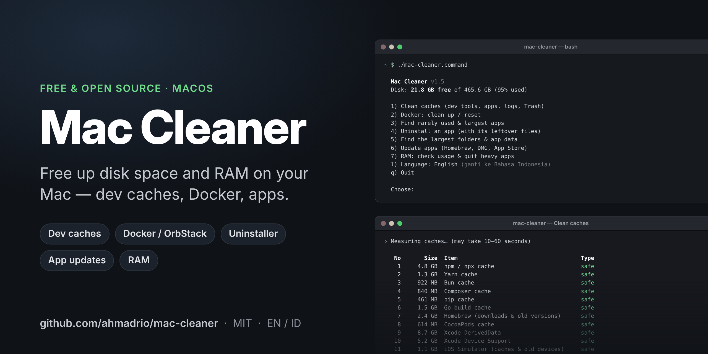

# Mac Cleaner

**Free, open-source disk cleaner for macOS — built with developers in mind.**
A Mac app, or the same tools as one interactive script for the Terminal. No sudo, no dependencies. English & Bahasa Indonesia.

🇮🇩 [Baca dalam Bahasa Indonesia](#bahasa-indonesia)

- 🧹 **Clean caches** — npm, Yarn, pnpm, Bun, Composer, pip, Go, Homebrew, Gradle, Maven, Flutter, NuGet, Xcode, iOS Simulator, `~/Library/Caches`, logs, Trash
- 🐳 **Docker / OrbStack** — pick exactly which containers, images, volumes, build cache or networks to remove, clean everything unused at once, or do a full reset
- 📦 **Find rarely used & large apps** — sorted by size, with "last opened" from macOS
- 🗑️ **Uninstall apps completely** — the app plus its leftover files in `~/Library` (preferences, caches, containers, app data…), moved to the Trash
- ⬆️ **Update apps** — Homebrew formulae & casks, apps installed from a DMG, apps with a Sparkle updater, and App Store apps, in one list
- 🧠 **RAM** — memory pressure and the apps using the most memory (helpers included), quit the ones you pick, or `purge` the file cache
- 📊 **Find the largest folders & app data** in your home folder and `~/Library`, then reveal them in Finder

## Mac app (no Terminal needed)

**[Download Mac Cleaner](https://github.com/ahmadrio/mac-cleaner/releases/latest)**: the `Mac-Cleaner-<version>.zip` file under *Assets*.

Requires a Mac with Apple Silicon (M1 or newer) and macOS 13+. Intel Macs: use the [script below](#command-line).

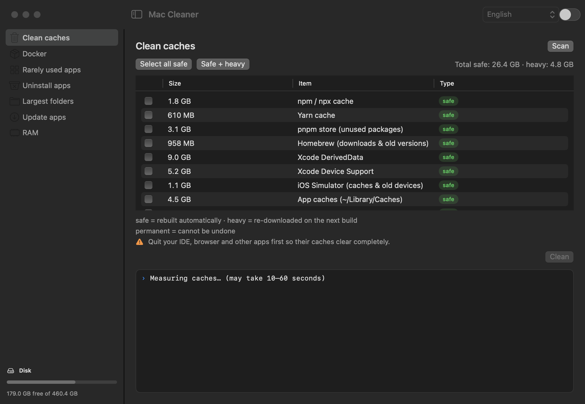

Every screen shows what it found before anything is deleted, and nothing is deleted until you confirm. To see what would happen without deleting anything, turn on the switch labelled **Dry run** at the top right; a yellow banner shows while it's on. The language menu next to it switches between English and Bahasa Indonesia.

### First open

Mac Cleaner isn't notarized by Apple, so macOS asks you to confirm it once:

1. Unzip `Mac-Cleaner-<version>.zip` (double-click it).
2. Drag **Mac Cleaner** into **Applications** first. Opened straight from Downloads, macOS runs it from a temporary copy, and the permissions you grant may not stick.
3. Open it. When macOS says it can't verify the app, close the message (don't choose *Move to Trash*). Then go to **System Settings → Privacy & Security**, scroll down to **Security** and click **Open Anyway** next to Mac Cleaner. The button only appears after you've tried to open the app once, so if it isn't there, open Mac Cleaner again first. Confirm, with your password if macOS asks. From then on it opens like any other app.

If macOS says instead that Mac Cleaner **is damaged and can't be opened**, there is no Open Anyway button for it. Open **Terminal** (Applications → Utilities), paste this line, press Return, then open Mac Cleaner again:

```bash
xattr -dr com.apple.quarantine "/Applications/Mac Cleaner.app"
```

### Permissions

macOS asks for these only when a feature needs one. If Finder control or Full Disk Access is missing, Mac Cleaner says so on that screen, with an **Open System Settings** button. App Management can't be checked in advance, so the confirmation of every cask or DMG update shows a reminder about it with the same button, even when it's already on; then just continue.

| Permission | Why Mac Cleaner needs it | How to turn it on |
| --- | --- | --- |
| Finder control (Automation) | To move apps and their leftover files to the Trash, and to empty the Trash | Click **Allow** (or **OK**) when macOS asks. Later: System Settings → Privacy & Security → **Automation** → Mac Cleaner → **Finder** |
| Full Disk Access | To measure `~/Library/Containers` (sandboxed apps' data) in *Largest folders*, and the size of the Trash | System Settings → Privacy & Security → **Full Disk Access** → turn on **Mac Cleaner** (add it with **+** if it isn't listed). Optional |
| App Management | So updates can replace apps in Applications (*Update apps*: Homebrew casks and DMG apps) | If macOS says Mac Cleaner was prevented from modifying apps: System Settings → Privacy & Security → **App Management** → turn on **Mac Cleaner**. The reminder in the update confirmation shows either way |

### Updating Mac Cleaner

Choose **Mac Cleaner › Check for Updates…** in the menu bar. If a newer version is out, Mac Cleaner shows what's new; **Update & reopen** then downloads it from the GitHub release, checks it against the release's SHA-256, puts the old version in the Trash and opens the new one. With **Dry run** on, it only downloads and checks. Mac Cleaner never checks by itself.

- 2.1.0 and older don't have this menu item yet: download the new version by hand once, as above.
- If macOS says Mac Cleaner was prevented from modifying apps, turn on **Mac Cleaner** under **App Management** (see the table above), then try again.
- After an update macOS may treat Mac Cleaner as a new app, so you may need to grant the permissions above again. An update you download by hand also needs **Open Anyway** once more; one installed through Check for Updates doesn't.

**Rarely used apps** — sorted by size, with when each app was last opened

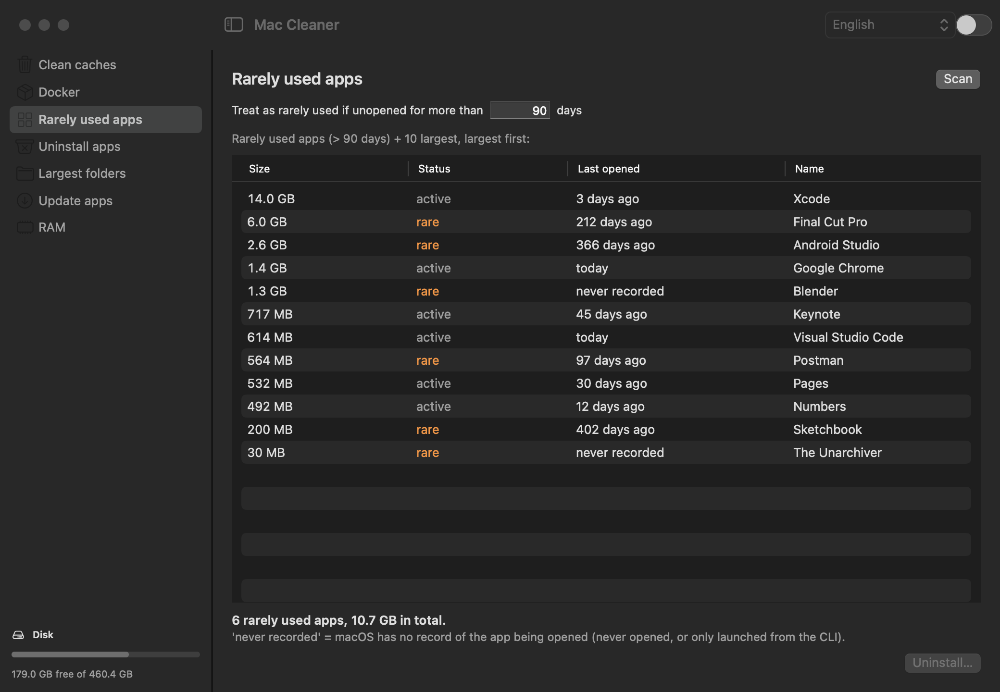

**Update apps** — Homebrew, DMG apps, apps with their own updater and the App Store in one list

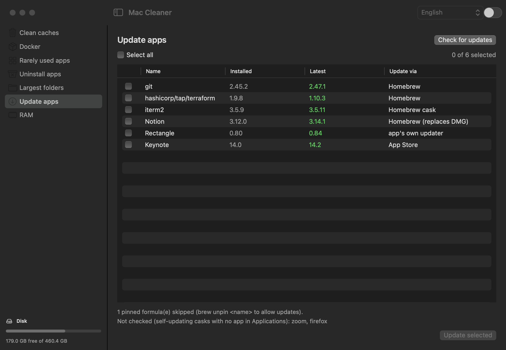

<table>
  <tr>
    <td width="50%"><b>Docker</b> — containers, images, volumes and build cache entries to pick, plus the clean-everything actions<br>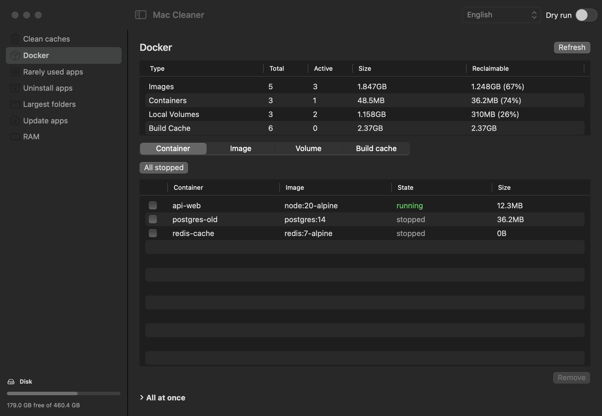</td>
    <td width="50%"><b>Uninstall apps</b> — search, then see the app and its leftover files before anything moves<br>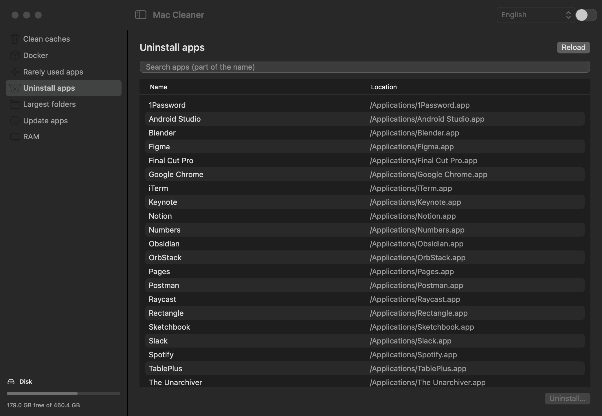</td>
  </tr>
  <tr>
    <td width="50%"><b>Largest folders</b> — where the space goes, with Show in Finder<br>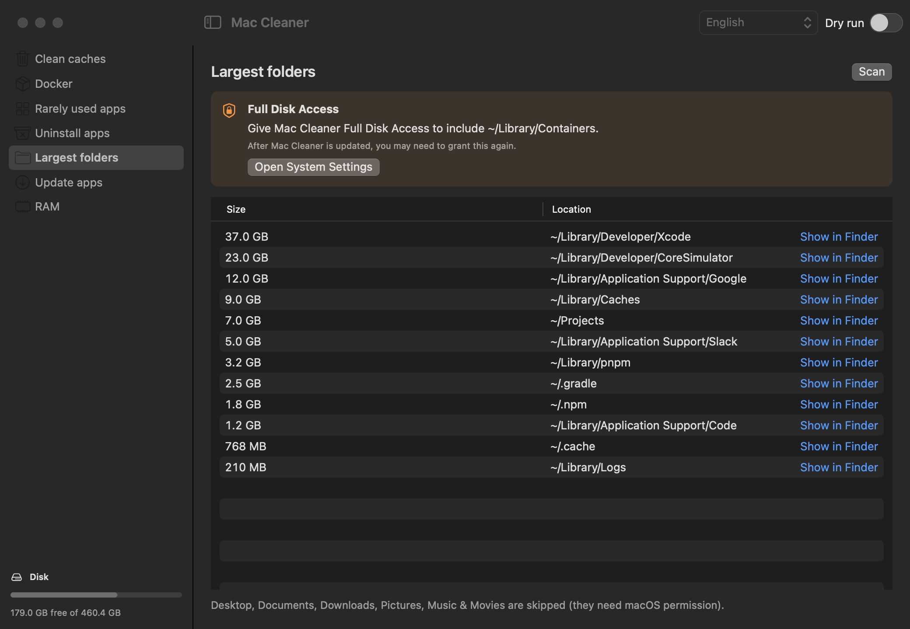</td>
    <td width="50%"><b>RAM</b> — memory pressure and the heaviest apps, which you can quit<br>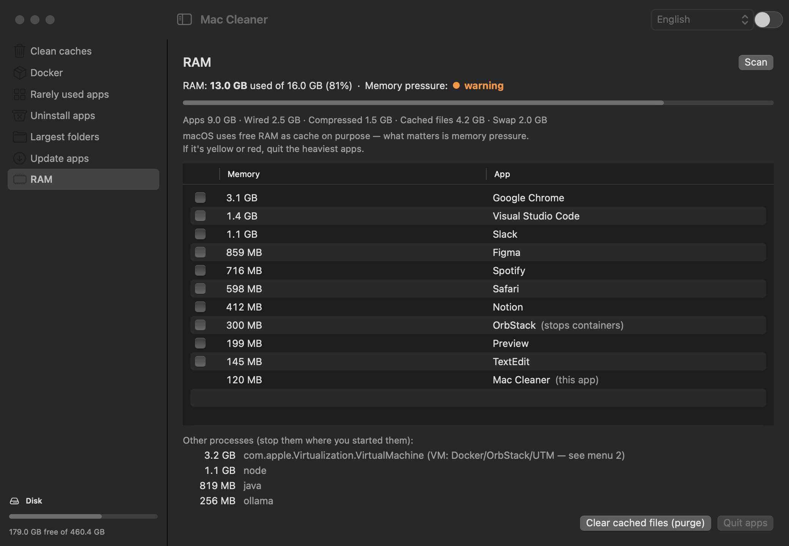</td>
  </tr>
</table>

*Screenshots use demo data — your items and sizes will differ.*

## Command line

Prefer the Terminal, or on an Intel Mac? Every tool is also one interactive script: no install, no sudo, no dependencies.

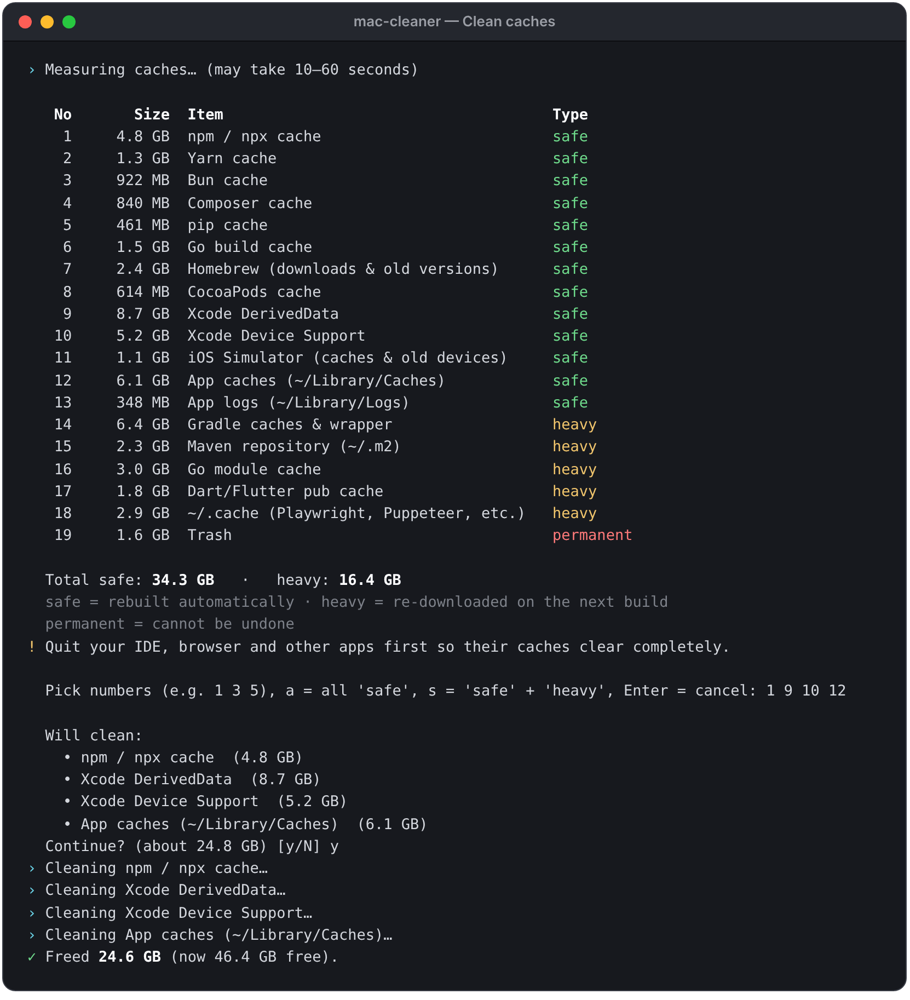

### Quick start

Run it straight from GitHub (nothing is installed):

```bash
# Try it first: shows what would be deleted, deletes nothing
bash <(curl -fsSL https://raw.githubusercontent.com/ahmadrio/mac-cleaner/main/mac-cleaner.command) --dry-run

# Run for real
bash <(curl -fsSL https://raw.githubusercontent.com/ahmadrio/mac-cleaner/main/mac-cleaner.command)
```

Or keep a copy you can double-click in Finder:

```bash
git clone https://github.com/ahmadrio/mac-cleaner.git
open mac-cleaner          # then double-click mac-cleaner.command
```

### Options

| Option | What it does |
| --- | --- |
| `--dry-run`, `-n` | Show what would be deleted without deleting anything |
| `--lang en` / `--lang id` | Force English or Bahasa Indonesia |
| `--help`, `-h` | Show help |

The language follows your macOS language by default. Switch it any time with **`l`** in the main menu — your choice is remembered (`~/.config/mac-cleaner/lang`). You can also set `MAC_CLEANER_LANG=en|id`.

### Screenshots

**Main menu**

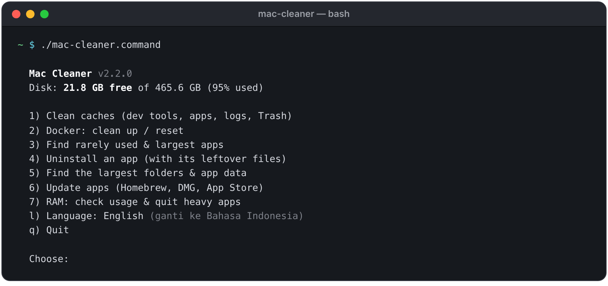

**Rarely used & largest apps** — sorted by size, with when each app was last opened

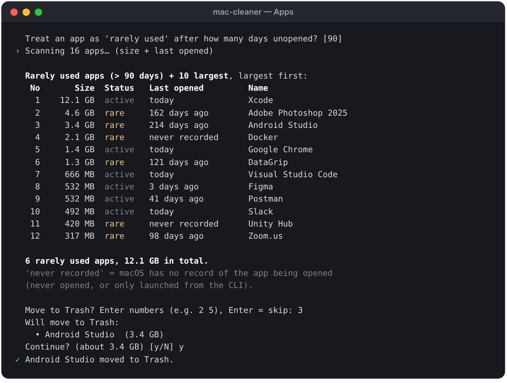

**Uninstall an app** — the app and every leftover file are listed (with sizes) before anything moves

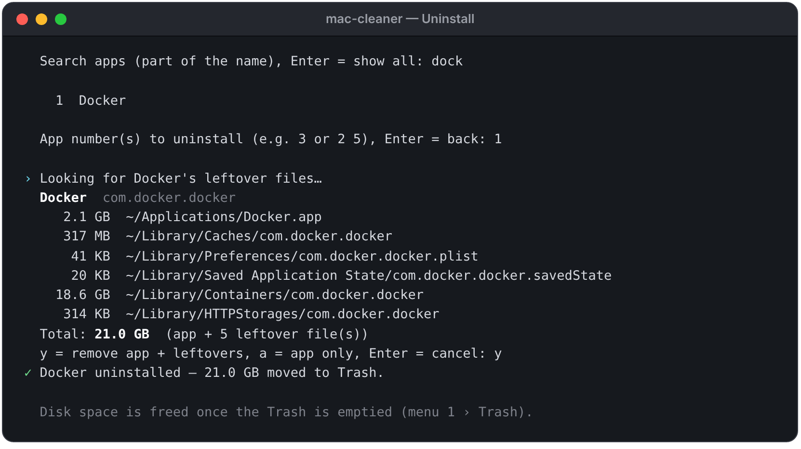

**Update apps** — everything that has a newer version, with where the update comes from

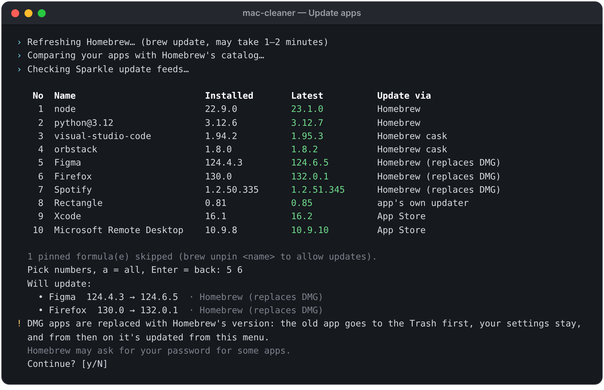

**RAM** — memory pressure, the heaviest apps, and how much RAM quitting them freed

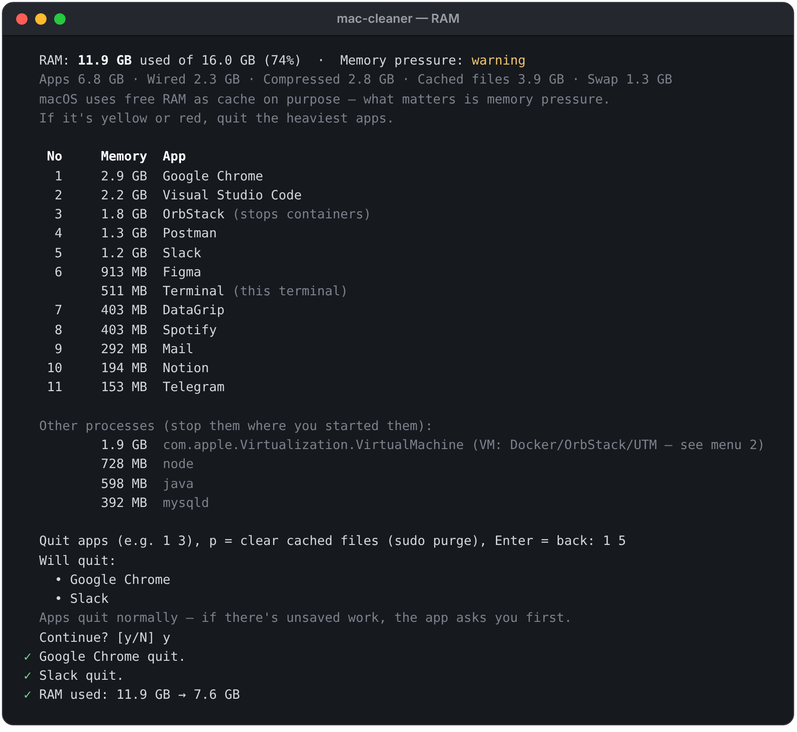

**Docker / OrbStack** — choose by type, then pick the exact items; images and volumes still used by a container are protected

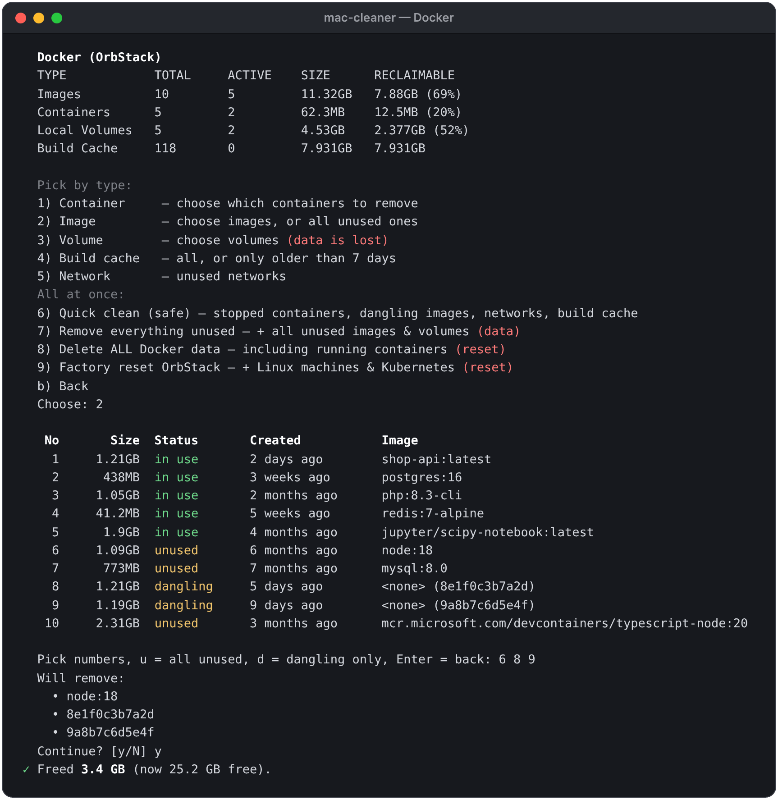

*Screenshots use demo data — your items and sizes will differ.*

## What gets cleaned

Every item shows its size first and only runs after you confirm. Items are labelled:

- **safe** — rebuilt automatically when needed
- **heavy** — re-downloaded on your next build (needs internet, first build is slower)
- **permanent** — cannot be undone (emptying the Trash)

| Item | Location / command | Type |
| --- | --- | --- |
| npm / npx | `~/.npm/_cacache`, `_npx`, `_logs` | safe |
| Yarn | `~/Library/Caches/Yarn`, `~/.yarn/berry/cache` | safe |
| pnpm | `pnpm store prune` (only unreferenced packages) | safe |
| Bun | `~/.bun/install/cache` | safe |
| Composer | `~/Library/Caches/composer`, `~/.composer/cache` | safe |
| pip | `~/Library/Caches/pip` | safe |
| Go build cache | `go env GOCACHE` | safe |
| Homebrew | `brew cleanup --prune=all -s` | safe |
| CocoaPods | `~/Library/Caches/CocoaPods` | safe |
| Xcode | `DerivedData`, `iOS/watchOS DeviceSupport` | safe |
| iOS Simulator | `xcrun simctl delete unavailable` + simulator caches | safe |
| App caches | `~/Library/Caches/*` (Apple system caches are skipped) | safe |
| App logs | `~/Library/Logs` | safe |
| Gradle | `~/.gradle/caches`, `~/.gradle/wrapper/dists` | heavy |
| Maven | `~/.m2/repository` | heavy |
| Go modules | `go clean -modcache` | heavy |
| Dart / Flutter | `~/.pub-cache/hosted`, `~/.pub-cache/git` | heavy |
| NuGet | `~/.nuget/packages` | heavy |
| `~/.cache` | Playwright browsers, Puppeteer, other CLI caches | heavy |
| Trash | Empties the Trash via Finder | permanent |

### Docker (OrbStack or Docker Desktop)

**Pick by type** — each one lists the items first so you can choose numbers:

| Option | What you see / can pick |
| --- | --- |
| 1. Container | name, status (running / exited), size, image · pick numbers or `s` = all stopped. Running ones are stopped first. |
| 2. Image | size, status (**in use** / unused / dangling), age · pick numbers, `u` = all unused, `d` = dangling only. Images in use are skipped. |
| 3. Volume | size and which container uses it · pick numbers or `u` = all unused; type `DELETE` to confirm. Volumes in use are skipped. |
| 4. Build cache | remove all, or only cache older than 7 days |
| 5. Network | remove unused custom networks (`bridge`/`host`/`none` are kept) |

**All at once:**

6. **Quick clean (safe)** — stopped containers, dangling images, unused networks, build cache. Volumes are not touched.
7. **Remove everything unused** — also all unused images and **all unused volumes**; type `DELETE`. ⚠️ Includes database volumes of projects stopped with `docker compose down`.
8. **Delete ALL Docker data** — every container (even running), image, volume, network and build cache; type `RESET`. Works with OrbStack and Docker Desktop.
9. **Factory reset OrbStack** — `orb reset`, also removes Linux machines and Kubernetes; type `RESET`. For Docker Desktop, the menu points you to *Troubleshoot › Clean / Purge data* to shrink its disk image.

OrbStack returns freed disk space to macOS automatically.

## Uninstalling apps

Menu **4** (or pick an app straight from the rarely-used list in menu **3**). Search by name, pick an app, and Mac Cleaner shows the app plus everything it left in your `~/Library`:

`Application Support`, `Caches`, `Logs`, `Preferences` (incl. `ByHost`), `Saved Application State`, `Containers`, `Group Containers`, `HTTPStorages`, `WebKit`, `Cookies`, `LaunchAgents`, `Application Scripts`.

- Files are matched by the app's **bundle ID** (e.g. `com.docker.docker`, its helpers, team/group containers) and by a folder with **exactly** the app's name.
- Files that belong to **another installed app** are never included (uninstalling Chrome leaves Chrome Canary alone). If two copies of the same app are installed, only the app is removed.
- Everything goes to the **Trash**, so you can put it back. Choose `a` to remove only the app.
- A running app is quit first (you're asked).
- System-level files in `/Library` (launch daemons, helper tools) are **shown but not removed** — they need an admin password.
- Apps installed in their own vendor folder (e.g. Adobe) get a hint to use the vendor's uninstaller. Installed with Homebrew? `brew uninstall --cask --zap <name>` also does a full cleanup.

## Updating apps

Menu **6** checks every source at once and shows one list with the installed and latest version:

| Source | How it's checked | How it's updated |
| --- | --- | --- |
| Homebrew formulae & casks | `brew update` + `brew outdated` | `brew upgrade` |
| Apps installed from a DMG/zip | version compared with [Homebrew's public cask catalog](https://formulae.brew.sh/cask/) | old app → Trash, then `brew install --cask` (settings in `~/Library` stay; from then on Homebrew updates it). Without Homebrew: opens the download page |
| Apps with a Sparkle updater (not in the catalog) | the app's own update feed (`SUFeedURL`) | opens the app so its updater can install the new version |
| App Store apps | `mas outdated` if [mas](https://github.com/mas-cli/mas) is installed | `mas upgrade`; without mas: opens the App Store updates page |

- Pick numbers or `a` for everything. Nothing is updated before you confirm.
- Pinned formulae are skipped.
- Casks that update themselves (`auto_updates`, e.g. VS Code, Zoom) are checked against the version of the app actually installed, not Homebrew's record, which goes stale once the app updates itself. Only apps that are really behind are listed. Self-updating casks with no app to check (CLI tools like `flutter`) are named in a note and skipped.
- Versions are compared component by component; when one version is just a longer form of the other (`6.2.11` vs `6.2.11.43613`) it counts as up to date, so you don't get false alarms.
- The cask catalog is downloaded once a day to `~/Library/Caches/mac-cleaner/`.

## RAM

Menu **7** shows how your memory is really doing and what's using it:

- **Memory pressure** (normal / warning / critical), plus used, app, wired, compressed, cached-files and swap memory — the same breakdown as Activity Monitor.
- **The apps using the most RAM**, with all their helper processes added up (all of Chrome's renderers count as "Google Chrome"). Heavy non-app processes (`node`, `java`, databases, Docker/OrbStack VMs) are listed too, so you know where the memory went.
- **Quit the apps you pick.** Apps are asked to quit normally, so they offer to save unsaved work. Finder, other parts of macOS and the terminal you're running Mac Cleaner in are never offered.
- **`p` runs `sudo purge`**, which empties the file cache. It asks for your password, and the effect is temporary.

A note on "RAM cleaners": macOS deliberately keeps free RAM filled with cache, because unused RAM is wasted RAM, so a high "used" number is normal. What slows a Mac down is **memory pressure**. When it's yellow or red, quitting the heaviest apps is what actually helps, and that's what this menu is built around.

## Safety

- No `sudo`. The script itself only deletes inside your home folder, and only the **contents** of known cache folders. Anything else is done by each tool's own command (`brew cleanup`, `docker … prune`, `orb reset`, `xcrun simctl`). When updating, Homebrew itself may ask for your password for some apps; the optional RAM `purge` asks for it too.
- Never touched: Desktop, Documents, Downloads, Pictures, Music, Movies, your projects, `~/.ssh`, Keychains. Preferences are only removed for an app you uninstall.
- Uninstalled apps and their leftovers are **moved to the Trash** (recoverable), never deleted directly.
- Use `--dry-run` first to see exactly what would happen.

## Requirements

- **Mac app:** a Mac with Apple Silicon (M1 or newer) and macOS 13 or later.
- **Script:** macOS on Apple Silicon or Intel. Uses the built-in `/bin/bash` 3.2 — nothing to install.
- Tools such as `brew`, `pnpm`, `go`, `docker`, `orb`, `mas` and `xcrun` are detected automatically; missing ones are simply skipped.
- Checking DMG apps and Sparkle feeds needs an internet connection.

## FAQ

**Free space didn't go up right away.** macOS may hold deleted space in APFS local snapshots for a while. Check again after a few minutes.

**An app shows "never recorded".** macOS has no record of it being opened — it was never opened, or only launched from the command line.

**Menu 5 doesn't count `~/Library/Containers`.** Those folders need *Full Disk Access*. Give it to Terminal (or to the Mac Cleaner app) in *System Settings › Privacy & Security › Full Disk Access* if you want them included. Without it, Mac Cleaner skips them so you don't get a flood of permission pop-ups.

**macOS asks whether Terminal or Mac Cleaner may "access data from other apps".** That happens when uninstalling a sandboxed app, because its leftovers live in `~/Library/Containers`. The script asks through Terminal; the app asks as soon as it shows an uninstall plan, because it measures those folders to show their size. Allowing it lets Mac Cleaner measure and move those files.

**macOS blocks double-clicking the file.** If you downloaded it with a browser, run `xattr -d com.apple.quarantine mac-cleaner.command` and `chmod +x mac-cleaner.command` once. Files from `git clone` or `curl` don't have this problem.

## Contributing

Issues and pull requests are welcome — especially new cache locations, translations, and bug reports with the output of `--dry-run`. Please keep it a single dependency-free script that runs on macOS's bash 3.2.

## License

[MIT](LICENSE) © Ahmad Rio. Provided as is, without warranty — review what you delete.

---

## Bahasa Indonesia

**Aplikasi pembersih disk gratis & open source untuk macOS — dibuat dengan kebutuhan developer.**
Berupa aplikasi Mac, atau semua fitur yang sama dalam satu script interaktif untuk Terminal. Tanpa sudo, tanpa dependency. Tersedia dalam Bahasa Indonesia & English.

- 🧹 **Bersihkan cache** — npm, Yarn, pnpm, Bun, Composer, pip, Go, Homebrew, Gradle, Maven, Flutter, NuGet, Xcode, Simulator iOS, `~/Library/Caches`, log, Trash
- 🐳 **Docker / OrbStack** — pilih sendiri container, image, volume, build cache, atau network yang mau dihapus, bersihkan semua yang tak terpakai sekaligus, atau full reset
- 📦 **Cari aplikasi jarang dipakai & paling besar** — urut dari yang terbesar, lengkap dengan "terakhir dibuka"
- 🗑️ **Uninstall aplikasi sampai bersih** — aplikasi beserta file sisanya di `~/Library` (preferensi, cache, container, data aplikasi…), dipindah ke Trash
- ⬆️ **Update aplikasi** — formula & cask Homebrew, aplikasi dari DMG, aplikasi ber-updater Sparkle, dan aplikasi App Store dalam satu daftar
- 🧠 **RAM** — memory pressure dan aplikasi yang paling boros RAM (termasuk helper-nya), tutup yang Anda pilih, atau `purge` cache file
- 📊 **Cari folder & data aplikasi terbesar** di folder home dan `~/Library`, lalu tampilkan di Finder

### Aplikasi Mac (tanpa Terminal)

**[Unduh Mac Cleaner](https://github.com/ahmadrio/mac-cleaner/releases/latest)**: file `Mac-Cleaner-<versi>.zip` di bagian *Assets*.

Butuh Mac dengan Apple Silicon (M1 atau lebih baru) dan macOS 13+. Mac Intel: pakai [script di bawah](#lewat-terminal-script).


Setiap layar menampilkan dulu apa yang ditemukan, dan tidak ada yang dihapus sebelum Anda konfirmasi. Untuk melihat apa yang akan terjadi tanpa menghapus apa pun, nyalakan sakelar berlabel **Mode coba** di kanan atas; selama aktif, spanduk kuning muncul di atas layar. Menu bahasa di sebelahnya mengganti tampilan antara Bahasa Indonesia dan English.

#### Pertama kali dibuka

Mac Cleaner belum dinotarisasi Apple, jadi macOS meminta Anda mengonfirmasinya sekali:

1. Unzip `Mac-Cleaner-<versi>.zip` (double-click file-nya).
2. Seret **Mac Cleaner** ke folder **Applications** dulu. Kalau dibuka langsung dari Downloads, macOS menjalankannya dari salinan sementara, dan izin yang Anda berikan bisa hilang.
3. Buka aplikasinya. Saat macOS bilang tidak bisa memverifikasi aplikasi ini, tutup pesannya (jangan pilih memindahkannya ke Trash). Lalu buka **Pengaturan Sistem → Privasi & Keamanan**, gulir ke bagian **Keamanan**, dan klik **Tetap Buka** di samping Mac Cleaner. Tombol ini baru muncul setelah Anda mencoba membuka aplikasinya sekali, jadi kalau belum ada, buka Mac Cleaner sekali lagi. Konfirmasi, dengan password Anda kalau macOS memintanya. Setelah itu Mac Cleaner terbuka seperti aplikasi lain.

Kalau macOS malah bilang Mac Cleaner **rusak dan tidak bisa dibuka**, tombol Tetap Buka tidak akan muncul. Buka **Terminal** (Applications → Utilities), tempel baris ini, tekan Return, lalu buka Mac Cleaner lagi:

```bash
xattr -dr com.apple.quarantine "/Applications/Mac Cleaner.app"
```

#### Izin

macOS hanya meminta izin ini saat sebuah fitur membutuhkannya. Kalau kontrol Finder atau Akses Disk Penuh belum diberikan, Mac Cleaner memberi tahu di layar itu, lengkap dengan tombol **Buka Pengaturan Sistem**. Manajemen App tidak bisa dicek lebih dulu, jadi konfirmasi setiap update cask atau aplikasi DMG selalu menampilkan pengingat dengan tombol yang sama, meskipun izinnya sudah aktif; kalau begitu, lanjutkan saja.

| Izin | Untuk apa | Cara mengaktifkan |
| --- | --- | --- |
| Kontrol Finder (Otomatisasi) | Memindahkan aplikasi beserta file sisanya ke Trash, dan mengosongkan Trash | Klik **Izinkan** (atau **OK**) saat macOS bertanya. Nanti: Pengaturan Sistem → Privasi & Keamanan → **Otomatisasi** → Mac Cleaner → **Finder** |
| Akses Disk Penuh (Full Disk Access) | Mengukur `~/Library/Containers` (data aplikasi sandbox) di *Folder terbesar*, dan ukuran Trash | Pengaturan Sistem → Privasi & Keamanan → **Akses Disk Penuh** → nyalakan **Mac Cleaner** (tambahkan dengan **+** kalau belum ada di daftar). Opsional |
| Manajemen App (App Management) | Supaya update bisa mengganti aplikasi di Applications (*Update aplikasi*: cask Homebrew dan aplikasi DMG) | Kalau macOS bilang Mac Cleaner dicegah mengubah aplikasi: Pengaturan Sistem → Privasi & Keamanan → **Manajemen App** → nyalakan **Mac Cleaner**. Pengingat di konfirmasi update tetap muncul |

#### Memperbarui Mac Cleaner

Pilih **Mac Cleaner › Periksa Pembaruan…** di bar menu. Kalau ada versi yang lebih baru, Mac Cleaner menampilkan apa saja yang baru; **Update & buka ulang** lalu mengunduhnya dari rilis GitHub, mencocokkannya dengan SHA-256 rilis itu, memindahkan versi lama ke Trash, dan membuka versi baru. Kalau **Mode coba** aktif, versi baru hanya diunduh dan dicek. Mac Cleaner tidak pernah memeriksa sendiri.

- Versi 2.1.0 dan sebelumnya belum punya menu ini: unduh versi baru secara manual sekali, seperti di atas.
- Kalau macOS bilang Mac Cleaner dicegah mengubah aplikasi, nyalakan **Mac Cleaner** di **Manajemen App** (lihat tabel di atas), lalu coba lagi.
- Setelah diperbarui, macOS bisa menganggap Mac Cleaner aplikasi baru, jadi izin-izin di atas mungkin perlu diberikan lagi. Versi yang diunduh manual juga perlu **Tetap Buka** sekali lagi; versi yang dipasang lewat Periksa Pembaruan tidak.

*Tangkapan layar memakai data demo — item dan ukuran di Mac Anda akan berbeda. Screenshot aplikasi lainnya ada di bagian [Mac app](#mac-app-no-terminal-needed).*

### Lewat Terminal (script)

Lebih suka Terminal, atau memakai Mac Intel? Semua fitur juga tersedia sebagai satu script interaktif: tanpa instalasi, tanpa sudo, tanpa dependency.

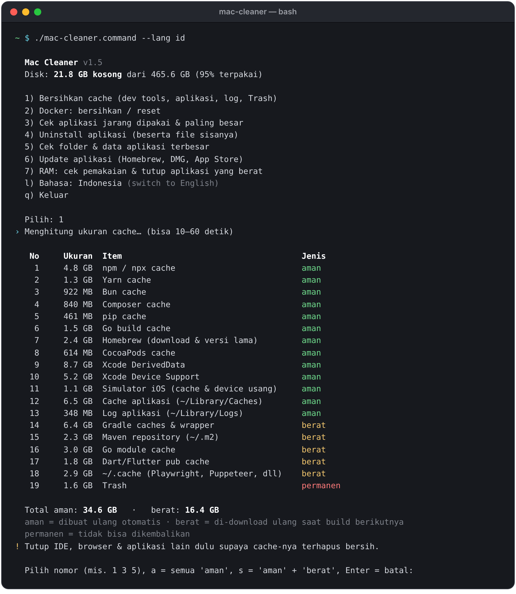

*Tangkapan layar memakai data demo — item dan ukuran di Mac Anda akan berbeda. Screenshot lain ada di bagian [Screenshots](#screenshots).*

#### Cara pakai

Jalankan langsung dari GitHub (tidak ada yang diinstal):

```bash
# Coba dulu: tampilkan apa yang akan dihapus, tanpa menghapus apa pun
bash <(curl -fsSL https://raw.githubusercontent.com/ahmadrio/mac-cleaner/main/mac-cleaner.command) --dry-run --lang id

# Jalankan sungguhan
bash <(curl -fsSL https://raw.githubusercontent.com/ahmadrio/mac-cleaner/main/mac-cleaner.command) --lang id
```

Atau simpan supaya bisa di-double-click dari Finder:

```bash
git clone https://github.com/ahmadrio/mac-cleaner.git
open mac-cleaner          # lalu double-click mac-cleaner.command
```

**Bahasa:** otomatis mengikuti bahasa macOS. Ganti kapan saja dengan menekan **`l`** di menu utama — pilihan Anda disimpan. Bisa juga pakai `--lang id` / `--lang en`.

### Yang dibersihkan

Setiap item ditampilkan ukurannya dulu dan baru dijalankan setelah Anda konfirmasi. Labelnya:

- **aman** — dibuat ulang otomatis saat dibutuhkan
- **berat** — di-download ulang saat build berikutnya (perlu internet, build pertama lebih lama)
- **permanen** — tidak bisa dikembalikan (mengosongkan Trash)

Daftar lengkap lokasi ada di tabel [What gets cleaned](#what-gets-cleaned) di atas.

**Docker — pilih per jenis** (daftar item ditampilkan dulu, lalu pilih nomornya):

1. **Container** — nama, status (berjalan/berhenti), ukuran · pilih nomor atau `s` = semua yang berhenti. Yang berjalan dihentikan dulu.
2. **Image** — ukuran, status (**dipakai** / tak dipakai / dangling) · pilih nomor, `u` = semua yang tak dipakai, `d` = dangling saja. Image yang dipakai dilewati.
3. **Volume** — ukuran dan container pemakainya · pilih nomor atau `u` = semua yang tak dipakai, lalu ketik `HAPUS`. Volume yang dipakai dilewati.
4. **Build cache** — semua, atau hanya yang lebih lama dari 7 hari.
5. **Network** — network buatan sendiri yang tidak dipakai.

**Sekaligus:** (6) bersihkan cepat (aman) — volume tidak disentuh; (7) hapus semua yang tak dipakai termasuk volume — ketik `HAPUS`, ⚠️ termasuk volume database proyek yang sudah `docker compose down`; (8) hapus SEMUA data Docker termasuk yang berjalan — ketik `RESET`; (9) factory reset OrbStack (`orb reset`) — ketik `RESET`.

### Uninstall aplikasi

Pakai menu **4** (atau pilih langsung dari daftar aplikasi jarang dipakai di menu **3**). Cari nama aplikasinya, pilih, lalu Mac Cleaner menampilkan aplikasi beserta semua file sisanya di `~/Library` lengkap dengan ukurannya.

- File dicocokkan lewat **bundle ID** aplikasi dan folder yang namanya **persis** sama dengan nama aplikasi.
- File milik **aplikasi lain yang masih terpasang** tidak pernah ikut (uninstall Chrome tidak menyentuh Chrome Canary). Kalau ada dua salinan aplikasi yang sama, hanya aplikasinya yang dihapus.
- Semuanya dipindah ke **Trash**, jadi bisa dikembalikan. Pilih `a` untuk menghapus aplikasinya saja.
- Aplikasi yang sedang berjalan akan ditutup dulu (dengan konfirmasi).
- File level sistem di `/Library` hanya **ditampilkan, tidak dihapus** (butuh password admin).
- Diinstal lewat Homebrew? `brew uninstall --cask --zap <nama>` juga membersihkan sampai tuntas.

### Update aplikasi

Menu **6** mengecek semua sumber sekaligus dan menampilkan satu daftar berisi versi terpasang dan versi terbaru:

- **Homebrew** (formula & cask) — dicek dengan `brew outdated`, diupdate dengan `brew upgrade`. Cask yang update sendiri (`auto_updates`, misalnya VS Code, Zoom) dicek terhadap versi aplikasi yang benar-benar terpasang, bukan catatan Homebrew yang sering basi. Jadi yang muncul hanya aplikasi yang memang tertinggal. Cask seperti ini yang tidak punya aplikasi (alat CLI seperti `flutter`) disebut di catatan dan dilewati.
- **Aplikasi dari DMG/zip** — versinya dibandingkan dengan katalog cask Homebrew. Update-nya: aplikasi lama dipindah ke Trash, lalu dipasang versi terbaru lewat `brew install --cask` (setting di `~/Library` tetap ada, dan selanjutnya diupdate lewat Homebrew). Kalau tidak ada Homebrew, halaman download-nya yang dibuka.
- **Aplikasi dengan updater Sparkle** — dicek lewat feed update aplikasinya, lalu aplikasinya dibuka supaya updater-nya memasang versi baru.
- **App Store** — lewat `mas` kalau terpasang; kalau tidak, halaman update App Store dibuka.

Pilih nomor atau `a` untuk semua; tidak ada yang diupdate sebelum Anda konfirmasi. Formula yang di-pin dilewati.

### RAM

Menu **7** menampilkan kondisi memori yang sebenarnya dan siapa yang memakainya:

- **Memory pressure** (normal / peringatan / kritis), plus rincian RAM terpakai, aplikasi, wired, terkompresi, cache file, dan swap — sama seperti Activity Monitor.
- **Aplikasi yang paling boros RAM**, dengan semua proses helper-nya dijumlahkan (semua proses Chrome dihitung sebagai "Google Chrome"). Proses berat lain (`node`, `java`, database, VM Docker/OrbStack) juga ditampilkan.
- **Tutup aplikasi yang Anda pilih.** Aplikasi ditutup secara normal, jadi tetap menawarkan untuk menyimpan pekerjaan. Finder, bagian sistem macOS, dan terminal yang sedang menjalankan Mac Cleaner tidak pernah ditawarkan.
- **`p` menjalankan `sudo purge`** untuk mengosongkan cache file. Butuh password, dan efeknya sementara.

Catatan soal "pembersih RAM": macOS sengaja mengisi RAM kosong dengan cache, jadi angka "terpakai" yang tinggi itu normal. Yang membuat Mac lambat adalah **memory pressure**. Kalau kuning atau merah, menutup aplikasi yang paling berat adalah cara yang benar-benar membantu.

### Keamanan

- Tanpa `sudo`. Script ini hanya menghapus di dalam folder home, dan hanya **isi** folder cache yang dikenal. Selebihnya dikerjakan perintah bawaan tiap tool (`brew cleanup`, `docker … prune`, `orb reset`, `xcrun simctl`). Saat update, Homebrew sendiri mungkin meminta password untuk beberapa aplikasi; opsi `purge` di menu RAM juga meminta password.
- Tidak pernah disentuh: Desktop, Documents, Downloads, Pictures, Music, Movies, proyek Anda, `~/.ssh`, Keychain. Preferences hanya dihapus untuk aplikasi yang Anda uninstall.
- Aplikasi yang di-uninstall beserta file sisanya **dipindah ke Trash** (bisa dikembalikan).
- Pakai `--dry-run` dulu untuk melihat persis apa yang akan terjadi.

### Pertanyaan umum

- **Ruang kosong tidak langsung bertambah?** macOS kadang menahan ruang di snapshot APFS. Cek lagi beberapa menit kemudian.
- **Aplikasi "tidak tercatat"?** macOS tidak punya catatan kapan aplikasi itu dibuka (belum pernah dibuka, atau hanya lewat CLI).
- **Menu 5 tidak menghitung `~/Library/Containers`?** Folder itu butuh *Full Disk Access*. Aktifkan untuk Terminal (atau untuk aplikasi Mac Cleaner) di *System Settings › Privacy & Security › Full Disk Access*.
- **macOS bertanya apakah Terminal atau Mac Cleaner boleh "mengakses data dari aplikasi lain"?** Itu muncul saat uninstall aplikasi sandbox, karena file sisanya ada di `~/Library/Containers`. Script bertanya lewat Terminal; aplikasinya bertanya begitu menampilkan rencana uninstall, karena folder itu diukur untuk menampilkan ukurannya. Izinkan supaya Mac Cleaner bisa mengukur dan memindahkan file tersebut.
- **File tidak bisa di-double-click?** Kalau di-download lewat browser, jalankan sekali: `xattr -d com.apple.quarantine mac-cleaner.command` dan `chmod +x mac-cleaner.command`.

### Kontribusi

Issue dan pull request sangat diterima — terutama lokasi cache baru, terjemahan, dan laporan bug (sertakan output `--dry-run`).

### Lisensi

[MIT](LICENSE) © Ahmad Rio. Gratis untuk dipakai, diubah, dan dibagikan. Disediakan apa adanya — periksa dulu apa yang Anda hapus.
