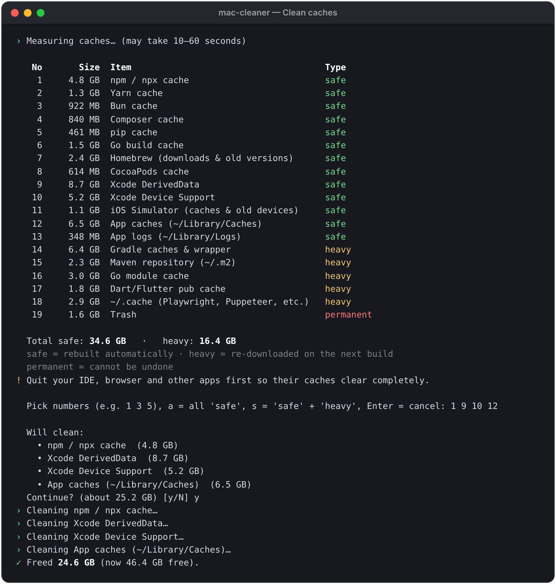
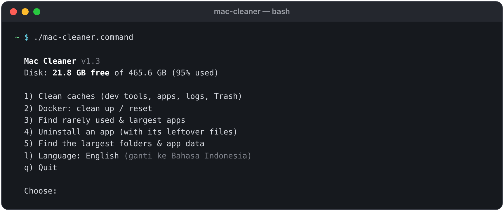
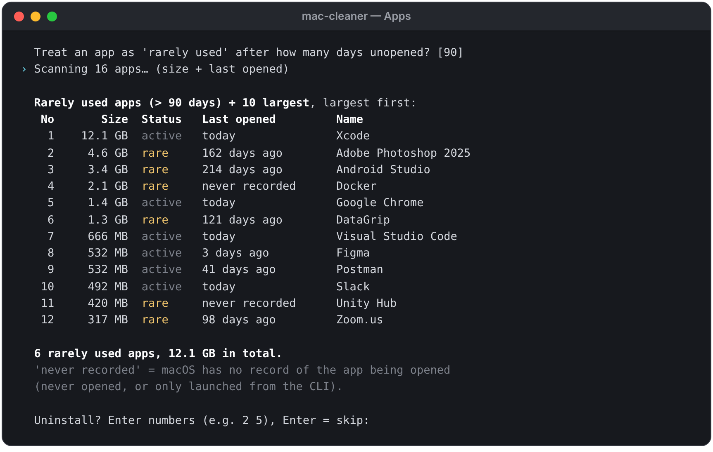
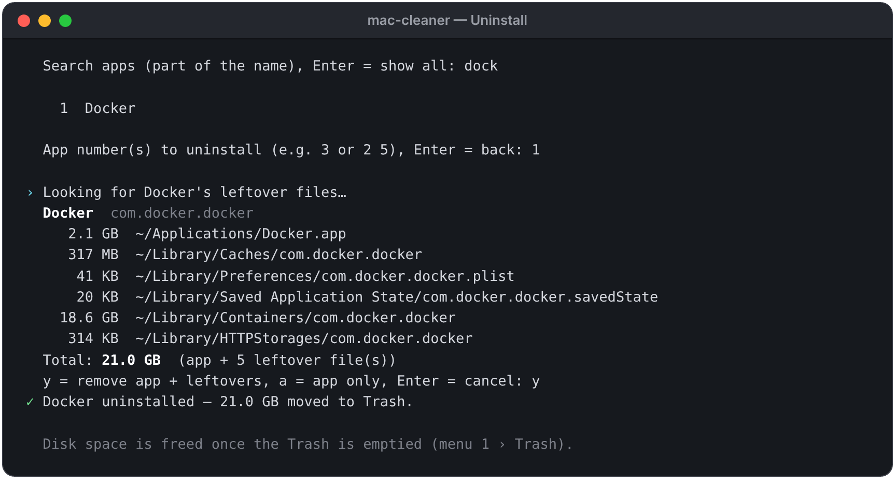
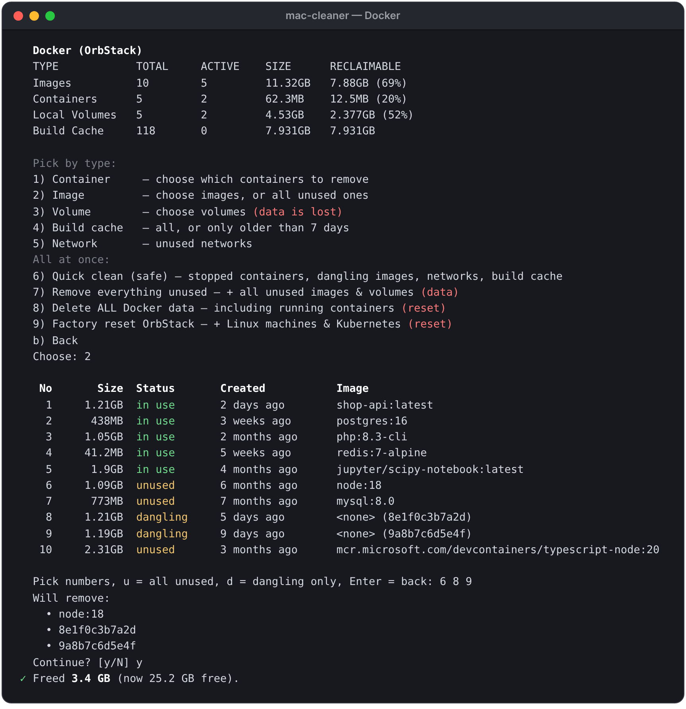
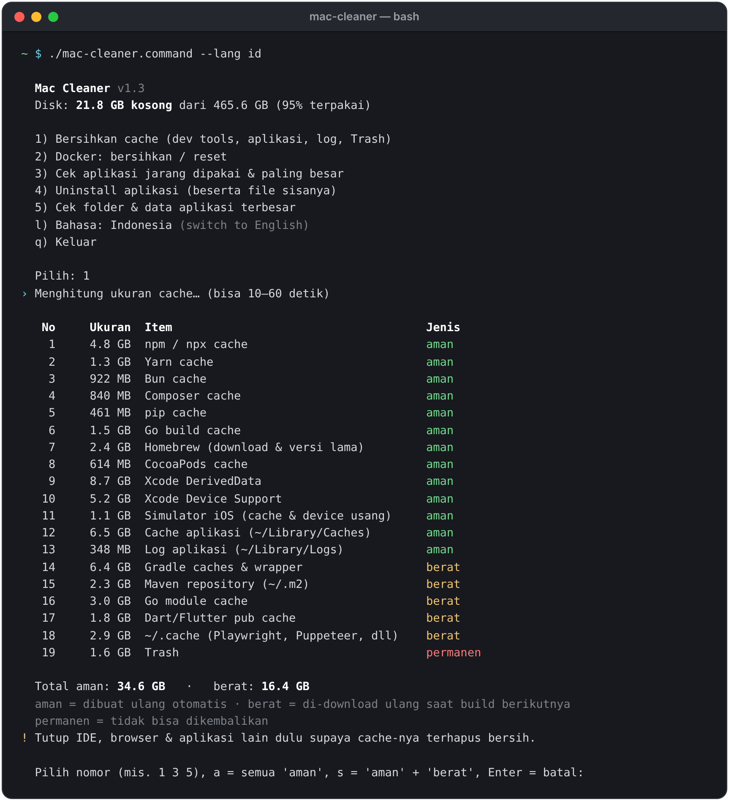

# Mac Cleaner

**Free, open-source disk cleaner for macOS — built with developers in mind.**
One interactive script, no install, no sudo, no dependencies. English & Bahasa Indonesia.

🇮🇩 [Baca dalam Bahasa Indonesia](#bahasa-indonesia)

- 🧹 **Clean caches** — npm, Yarn, pnpm, Bun, Composer, pip, Go, Homebrew, Gradle, Maven, Flutter, NuGet, Xcode, iOS Simulator, `~/Library/Caches`, logs, Trash
- 🐳 **Docker / OrbStack** — pick exactly which containers, images, volumes, build cache or networks to remove, clean everything unused at once, or do a full reset
- 📦 **Find rarely used & large apps** — sorted by size, with "last opened" from macOS
- 🗑️ **Uninstall apps completely** — the app plus its leftover files in `~/Library` (preferences, caches, containers, app data…), moved to the Trash
- 📊 **Find the largest folders & app data** in your home folder and `~/Library`, then reveal them in Finder



## Quick start

Run it straight from GitHub (nothing is installed):

```bash
# Try it first: shows what would be deleted, deletes nothing
bash <(curl -fsSL https://raw.githubusercontent.com/ahmadrio/mac-cleaner/main/mac-cleaner.command) --dry-run

# Run for real
bash <(curl -fsSL https://raw.githubusercontent.com/ahmadrio/mac-cleaner/main/mac-cleaner.command)
```

Or keep a copy you can double-click in Finder:

```bash
git clone https://github.com/ahmadrio/mac-cleaner.git
open mac-cleaner          # then double-click mac-cleaner.command
```

### Options

| Option | What it does |
| --- | --- |
| `--dry-run`, `-n` | Show what would be deleted without deleting anything |
| `--lang en` / `--lang id` | Force English or Bahasa Indonesia |
| `--help`, `-h` | Show help |

The language follows your macOS language by default. Switch it any time with **`l`** in the main menu — your choice is remembered (`~/.config/mac-cleaner/lang`). You can also set `MAC_CLEANER_LANG=en|id`.

## Screenshots

**Main menu**



**Rarely used & largest apps** — sorted by size, with when each app was last opened



**Uninstall an app** — the app and every leftover file are listed (with sizes) before anything moves



**Docker / OrbStack** — choose by type, then pick the exact items; images and volumes still used by a container are protected



*Screenshots use demo data — your items and sizes will differ.*

## What gets cleaned

Every item shows its size first and only runs after you confirm. Items are labelled:

- **safe** — rebuilt automatically when needed
- **heavy** — re-downloaded on your next build (needs internet, first build is slower)
- **permanent** — cannot be undone (emptying the Trash)

| Item | Location / command | Type |
| --- | --- | --- |
| npm / npx | `~/.npm/_cacache`, `_npx`, `_logs` | safe |
| Yarn | `~/Library/Caches/Yarn`, `~/.yarn/berry/cache` | safe |
| pnpm | `pnpm store prune` (only unreferenced packages) | safe |
| Bun | `~/.bun/install/cache` | safe |
| Composer | `~/Library/Caches/composer`, `~/.composer/cache` | safe |
| pip | `~/Library/Caches/pip` | safe |
| Go build cache | `go env GOCACHE` | safe |
| Homebrew | `brew cleanup --prune=all -s` | safe |
| CocoaPods | `~/Library/Caches/CocoaPods` | safe |
| Xcode | `DerivedData`, `iOS/watchOS DeviceSupport` | safe |
| iOS Simulator | `xcrun simctl delete unavailable` + simulator caches | safe |
| App caches | `~/Library/Caches/*` (Apple system caches are skipped) | safe |
| App logs | `~/Library/Logs` | safe |
| Gradle | `~/.gradle/caches`, `~/.gradle/wrapper/dists` | heavy |
| Maven | `~/.m2/repository` | heavy |
| Go modules | `go clean -modcache` | heavy |
| Dart / Flutter | `~/.pub-cache/hosted`, `~/.pub-cache/git` | heavy |
| NuGet | `~/.nuget/packages` | heavy |
| `~/.cache` | Playwright browsers, Puppeteer, other CLI caches | heavy |
| Trash | Empties the Trash via Finder | permanent |

### Docker (OrbStack or Docker Desktop)

**Pick by type** — each one lists the items first so you can choose numbers:

| Option | What you see / can pick |
| --- | --- |
| 1. Container | name, status (running / exited), size, image · pick numbers or `s` = all stopped. Running ones are stopped first. |
| 2. Image | size, status (**in use** / unused / dangling), age · pick numbers, `u` = all unused, `d` = dangling only. Images in use are skipped. |
| 3. Volume | size and which container uses it · pick numbers or `u` = all unused; type `DELETE` to confirm. Volumes in use are skipped. |
| 4. Build cache | remove all, or only cache older than 7 days |
| 5. Network | remove unused custom networks (`bridge`/`host`/`none` are kept) |

**All at once:**

6. **Quick clean (safe)** — stopped containers, dangling images, unused networks, build cache. Volumes are not touched.
7. **Remove everything unused** — also all unused images and **all unused volumes**; type `DELETE`. ⚠️ Includes database volumes of projects stopped with `docker compose down`.
8. **Delete ALL Docker data** — every container (even running), image, volume, network and build cache; type `RESET`. Works with OrbStack and Docker Desktop.
9. **Factory reset OrbStack** — `orb reset`, also removes Linux machines and Kubernetes; type `RESET`. For Docker Desktop, the menu points you to *Troubleshoot › Clean / Purge data* to shrink its disk image.

OrbStack returns freed disk space to macOS automatically.

## Uninstalling apps

Menu **4** (or pick an app straight from the rarely-used list in menu **3**). Search by name, pick an app, and Mac Cleaner shows the app plus everything it left in your `~/Library`:

`Application Support`, `Caches`, `Logs`, `Preferences` (incl. `ByHost`), `Saved Application State`, `Containers`, `Group Containers`, `HTTPStorages`, `WebKit`, `Cookies`, `LaunchAgents`, `Application Scripts`.

- Files are matched by the app's **bundle ID** (e.g. `com.docker.docker`, its helpers, team/group containers) and by a folder with **exactly** the app's name.
- Files that belong to **another installed app** are never included (uninstalling Chrome leaves Chrome Canary alone). If two copies of the same app are installed, only the app is removed.
- Everything goes to the **Trash**, so you can put it back. Choose `a` to remove only the app.
- A running app is quit first (you're asked).
- System-level files in `/Library` (launch daemons, helper tools) are **shown but not removed** — they need an admin password.
- Apps installed in their own vendor folder (e.g. Adobe) get a hint to use the vendor's uninstaller. Installed with Homebrew? `brew uninstall --cask --zap <name>` also does a full cleanup.

## Safety

- No `sudo`. The script itself only deletes inside your home folder, and only the **contents** of known cache folders. Anything else is done by each tool's own cleanup command (`brew cleanup`, `docker … prune`, `orb reset`, `xcrun simctl`).
- Never touched: Desktop, Documents, Downloads, Pictures, Music, Movies, your projects, `~/.ssh`, Keychains. Preferences are only removed for an app you uninstall.
- Uninstalled apps and their leftovers are **moved to the Trash** (recoverable), never deleted directly.
- Use `--dry-run` first to see exactly what would happen.

## Requirements

- macOS (Apple Silicon or Intel). Uses the built-in `/bin/bash` 3.2 — nothing to install.
- Tools such as `brew`, `pnpm`, `go`, `docker`, `orb` and `xcrun` are detected automatically; missing ones are simply skipped.

## FAQ

**Free space didn't go up right away.** macOS may hold deleted space in APFS local snapshots for a while. Check again after a few minutes.

**An app shows "never recorded".** macOS has no record of it being opened — it was never opened, or only launched from the command line.

**Menu 5 doesn't count `~/Library/Containers`.** Those folders need *Full Disk Access*. Give it to Terminal in *System Settings › Privacy & Security › Full Disk Access* if you want them included. Without it, Mac Cleaner skips them so you don't get a flood of permission pop-ups.

**macOS asks whether Terminal may "access data from other apps".** That happens when uninstalling a sandboxed app, because its leftovers live in `~/Library/Containers`. Allowing it lets Mac Cleaner measure and move those files.

**macOS blocks double-clicking the file.** If you downloaded it with a browser, run `xattr -d com.apple.quarantine mac-cleaner.command` and `chmod +x mac-cleaner.command` once. Files from `git clone` or `curl` don't have this problem.

## Contributing

Issues and pull requests are welcome — especially new cache locations, translations, and bug reports with the output of `--dry-run`. Please keep it a single dependency-free script that runs on macOS's bash 3.2.

## License

[MIT](LICENSE) © Ahmad Rio. Provided as is, without warranty — review what you delete.

---

## Bahasa Indonesia

**Aplikasi pembersih disk gratis & open source untuk macOS — dibuat dengan kebutuhan developer.**
Satu script interaktif, tanpa instalasi, tanpa sudo, tanpa dependency. Tersedia dalam Bahasa Indonesia & English.

- 🧹 **Bersihkan cache** — npm, Yarn, pnpm, Bun, Composer, pip, Go, Homebrew, Gradle, Maven, Flutter, NuGet, Xcode, Simulator iOS, `~/Library/Caches`, log, Trash
- 🐳 **Docker / OrbStack** — pilih sendiri container, image, volume, build cache, atau network yang mau dihapus, bersihkan semua yang tak terpakai sekaligus, atau full reset
- 📦 **Cari aplikasi jarang dipakai & paling besar** — urut dari yang terbesar, lengkap dengan "terakhir dibuka"
- 🗑️ **Uninstall aplikasi sampai bersih** — aplikasi beserta file sisanya di `~/Library` (preferensi, cache, container, data aplikasi…), dipindah ke Trash
- 📊 **Cari folder & data aplikasi terbesar** di folder home dan `~/Library`, lalu tampilkan di Finder



*Tangkapan layar memakai data demo — item dan ukuran di Mac Anda akan berbeda. Screenshot lain ada di bagian [Screenshots](#screenshots).*

### Cara pakai

Jalankan langsung dari GitHub (tidak ada yang diinstal):

```bash
# Coba dulu: tampilkan apa yang akan dihapus, tanpa menghapus apa pun
bash <(curl -fsSL https://raw.githubusercontent.com/ahmadrio/mac-cleaner/main/mac-cleaner.command) --dry-run --lang id

# Jalankan sungguhan
bash <(curl -fsSL https://raw.githubusercontent.com/ahmadrio/mac-cleaner/main/mac-cleaner.command) --lang id
```

Atau simpan supaya bisa di-double-click dari Finder:

```bash
git clone https://github.com/ahmadrio/mac-cleaner.git
open mac-cleaner          # lalu double-click mac-cleaner.command
```

**Bahasa:** otomatis mengikuti bahasa macOS. Ganti kapan saja dengan menekan **`l`** di menu utama — pilihan Anda disimpan. Bisa juga pakai `--lang id` / `--lang en`.

### Yang dibersihkan

Setiap item ditampilkan ukurannya dulu dan baru dijalankan setelah Anda konfirmasi. Labelnya:

- **aman** — dibuat ulang otomatis saat dibutuhkan
- **berat** — di-download ulang saat build berikutnya (perlu internet, build pertama lebih lama)
- **permanen** — tidak bisa dikembalikan (mengosongkan Trash)

Daftar lengkap lokasi ada di tabel [What gets cleaned](#what-gets-cleaned) di atas.

**Docker — pilih per jenis** (daftar item ditampilkan dulu, lalu pilih nomornya):

1. **Container** — nama, status (berjalan/berhenti), ukuran · pilih nomor atau `s` = semua yang berhenti. Yang berjalan dihentikan dulu.
2. **Image** — ukuran, status (**dipakai** / tak dipakai / dangling) · pilih nomor, `u` = semua yang tak dipakai, `d` = dangling saja. Image yang dipakai dilewati.
3. **Volume** — ukuran dan container pemakainya · pilih nomor atau `u` = semua yang tak dipakai, lalu ketik `HAPUS`. Volume yang dipakai dilewati.
4. **Build cache** — semua, atau hanya yang lebih lama dari 7 hari.
5. **Network** — network buatan sendiri yang tidak dipakai.

**Sekaligus:** (6) bersihkan cepat (aman) — volume tidak disentuh; (7) hapus semua yang tak dipakai termasuk volume — ketik `HAPUS`, ⚠️ termasuk volume database proyek yang sudah `docker compose down`; (8) hapus SEMUA data Docker termasuk yang berjalan — ketik `RESET`; (9) factory reset OrbStack (`orb reset`) — ketik `RESET`.

### Uninstall aplikasi

Pakai menu **4** (atau pilih langsung dari daftar aplikasi jarang dipakai di menu **3**). Cari nama aplikasinya, pilih, lalu Mac Cleaner menampilkan aplikasi beserta semua file sisanya di `~/Library` lengkap dengan ukurannya.

- File dicocokkan lewat **bundle ID** aplikasi dan folder yang namanya **persis** sama dengan nama aplikasi.
- File milik **aplikasi lain yang masih terpasang** tidak pernah ikut (uninstall Chrome tidak menyentuh Chrome Canary). Kalau ada dua salinan aplikasi yang sama, hanya aplikasinya yang dihapus.
- Semuanya dipindah ke **Trash**, jadi bisa dikembalikan. Pilih `a` untuk menghapus aplikasinya saja.
- Aplikasi yang sedang berjalan akan ditutup dulu (dengan konfirmasi).
- File level sistem di `/Library` hanya **ditampilkan, tidak dihapus** (butuh password admin).
- Diinstal lewat Homebrew? `brew uninstall --cask --zap <nama>` juga membersihkan sampai tuntas.

### Keamanan

- Tanpa `sudo`. Script ini hanya menghapus di dalam folder home, dan hanya **isi** folder cache yang dikenal. Selebihnya dikerjakan perintah pembersih bawaan tiap tool (`brew cleanup`, `docker … prune`, `orb reset`, `xcrun simctl`).
- Tidak pernah disentuh: Desktop, Documents, Downloads, Pictures, Music, Movies, proyek Anda, `~/.ssh`, Keychain. Preferences hanya dihapus untuk aplikasi yang Anda uninstall.
- Aplikasi yang di-uninstall beserta file sisanya **dipindah ke Trash** (bisa dikembalikan).
- Pakai `--dry-run` dulu untuk melihat persis apa yang akan terjadi.

### Pertanyaan umum

- **Ruang kosong tidak langsung bertambah?** macOS kadang menahan ruang di snapshot APFS. Cek lagi beberapa menit kemudian.
- **Aplikasi "tidak tercatat"?** macOS tidak punya catatan kapan aplikasi itu dibuka (belum pernah dibuka, atau hanya lewat CLI).
- **Menu 5 tidak menghitung `~/Library/Containers`?** Folder itu butuh *Full Disk Access*. Aktifkan untuk Terminal di *System Settings › Privacy & Security › Full Disk Access*.
- **macOS bertanya apakah Terminal boleh "mengakses data dari aplikasi lain"?** Itu muncul saat uninstall aplikasi sandbox, karena file sisanya ada di `~/Library/Containers`. Izinkan supaya Mac Cleaner bisa mengukur dan memindahkan file tersebut.
- **File tidak bisa di-double-click?** Kalau di-download lewat browser, jalankan sekali: `xattr -d com.apple.quarantine mac-cleaner.command` dan `chmod +x mac-cleaner.command`.

### Kontribusi

Issue dan pull request sangat diterima — terutama lokasi cache baru, terjemahan, dan laporan bug (sertakan output `--dry-run`).

### Lisensi

[MIT](LICENSE) © Ahmad Rio. Gratis untuk dipakai, diubah, dan dibagikan. Disediakan apa adanya — periksa dulu apa yang Anda hapus.
